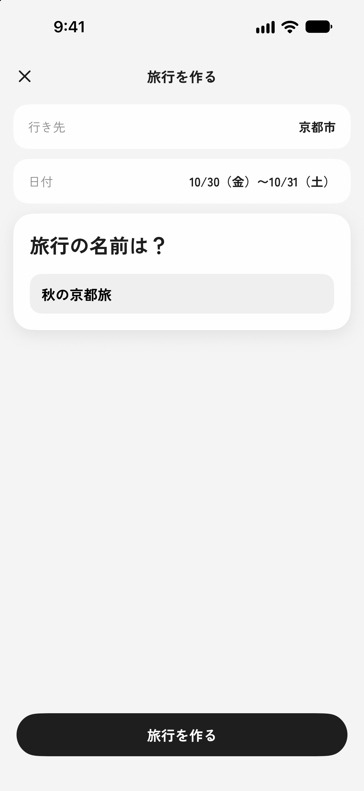
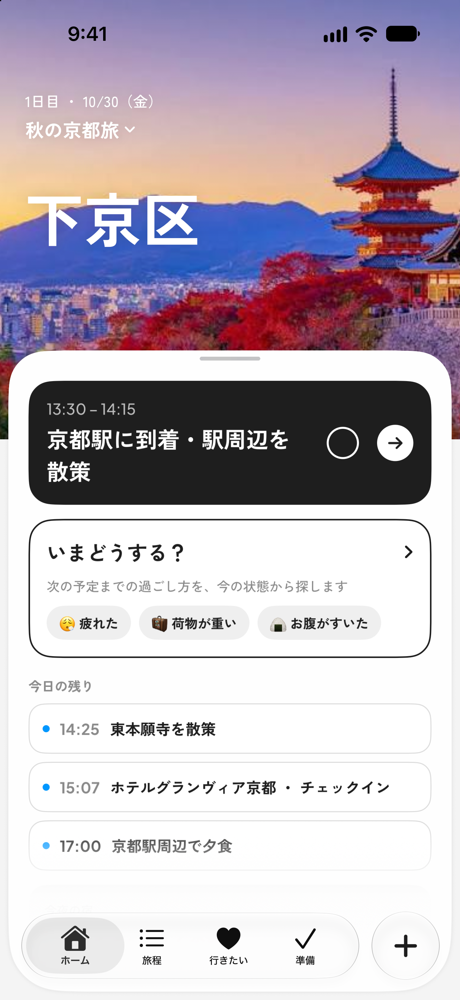
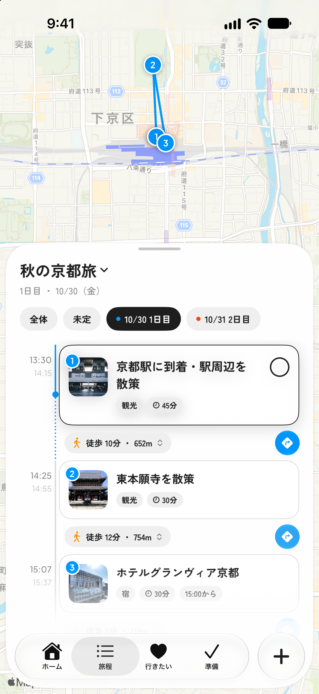
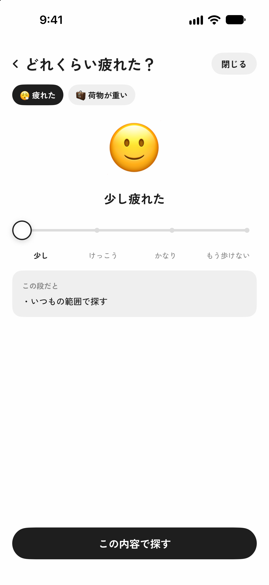
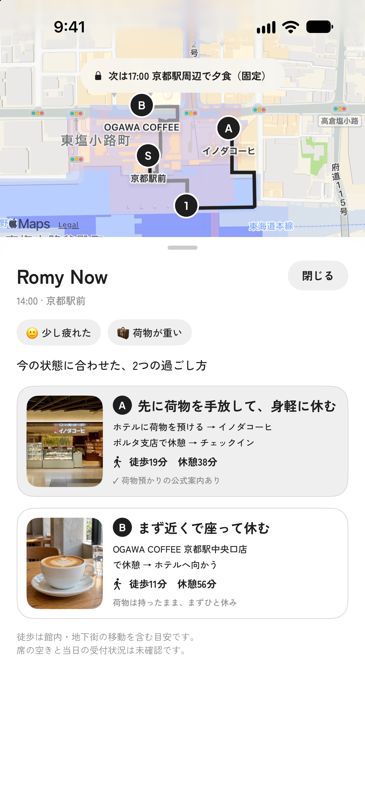
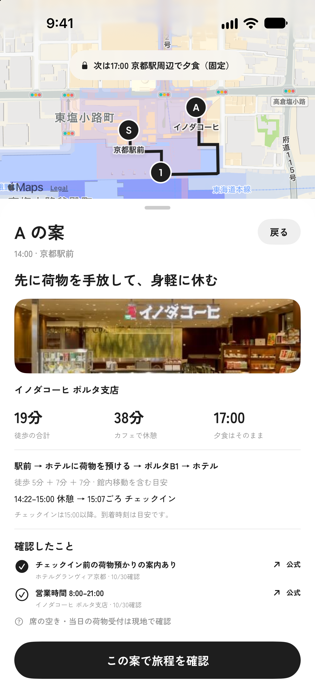
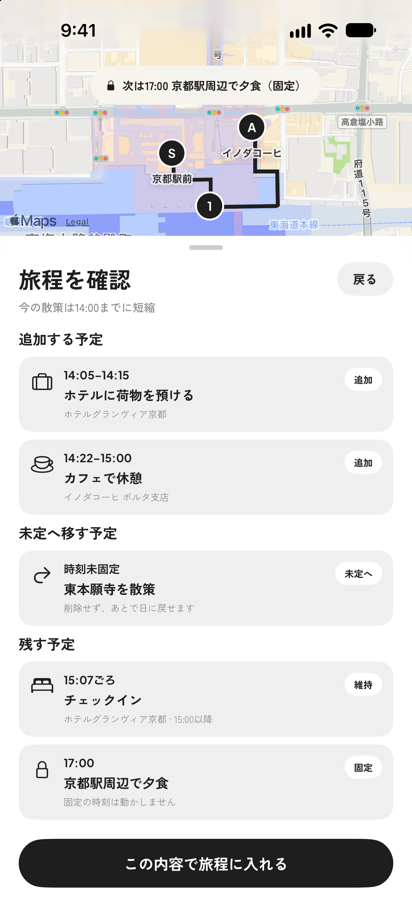
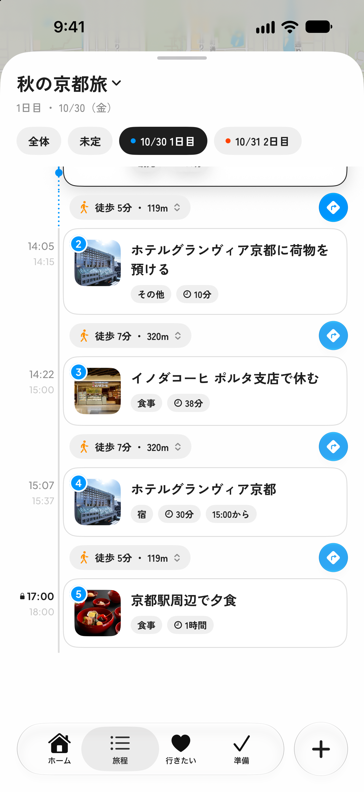

# Romy｜簡易仕様書

更新日：2026年10月30日。開発中の文書下書きです。記載の基準はアプリ開発版 `5b67050` と同日時点の確認記録です。この文書ブランチのソースコードとは未統合で、主要画面8枚を掲載しています。提出版の確定と最終確認結果は後からそろえます。

## 1．アプリ名

Romy（ロミー）

作者：北出琉和。個人開発として、企画・画面設計・実装・動作確認に取り組んでいます。

## 2．対象OS（バージョン情報を含む）

iOS 27.0以降（現行プロジェクトの最低対応OS設定）。主な画面確認環境はiPhone 17 Pro Max Simulator／iOS 27.0です。基本機能と純正タブバーへの変更に加え、公開中継に接続した宿の情報確認、次の固定予定がない場合の案生成、出典・ライセンス画面は、本人のiPhone実機でも動作を確認しています。

## 3．開発環境／言語

開発環境：macOS 27.0.1／Xcode 27.1。アプリはSwift／SwiftUIで開発しています。現在のSwiftコンパイラは6.4、プロジェクトの言語モードはSwift 5です。

補助ツール：Pythonを使い、旅行作成時の行き先検索に用いるデータを収集・整備しています。

中継サーバー：TypeScriptで開発し、Cloudflare Workers／D1へ公開しています。Wranglerでローカル実行・公開を行い、処理の検証にはVitestを使用しています。

開発管理・設計：Git／GitHub、Figma／FigJam。Mobbinで実際のアプリの画面や操作を調べ、UIを検討しています。AIも活用し、Issueに目的・対象範囲・確認方法を整理してから進め、変更内容と動作を自分で確かめています。

## 4．開発期間

制作期間：2026年7月〜現在（企画と旧版の試作を含む）。現行版の実装期間：2026年10月14日〜現在。

## 5．機能概要（機能一覧）

Romyは、旅行の計画・準備から旅行中の行動までを支えるiOSアプリです。例えば、歩き疲れて荷物も重いとき、次の予定までどう過ごせばよいか迷うことがあります。Romy Nowでは、現在地やそのときの状態、宿のチェックイン時刻、次の予約などを踏まえ、今からできる過ごし方を比較できます。

選んだ案は、変更内容を確認してから同じ旅程へ反映できます。旅行中の「今からどうしよう」という迷いや不安に寄り添い、自分に合う次の行動を選んで、旅行を楽しめる体験を目指しています。

### 処理の役割分担

- MapKit：場所の候補、徒歩経路、移動時間を取得します。

- Swiftで実装した処理：状態と旅程、移動・滞在時間から案を組み立て、比較・変更確認・旅程反映・取り消しを行います。

- 検索AI：宿の荷物預かりなどの公開情報を調べます。提案の条件判断や時間計算はSwift側で行います。

### 主な機能

| 機能 | 概要 |
| --- | --- |
| 旅行の作成・管理 | 行き先・日付・旅行名を設定し、旅行を作成します。日付が未定でも作成でき、最後に開いた旅行から再開できます。 |
| 予定・宿泊の登録と編集 | 場所検索や名前の入力から予定を追加し、日・順番・滞在時間などを編集できます。宿泊では泊数やチェックイン・チェックアウト時刻も管理します。 |
| 地図と旅程の表示 | 日ごとの予定と地図を組み合わせ、訪問順や位置関係を確認できます。本人が固定した時刻と、自動計算した目安時刻を区別して表示します。 |
| 移動の確認 | 予定間の移動手段や所要時間を確認し、Appleマップ・Googleマップで経路を開けます。 |
| 行きたい場所の保存 | 気になる場所を旅行ごとに保存し、選んだ日の旅程へ追加できます。追加後も保存した場所は残し、追加済みであることを示します。 |
| 状況に応じたホーム | 旅行前・前日・旅行中に応じて、次に行う準備や今の予定、今日の残りの予定などを表示します。 |
| 準備の管理 | 予約が必要な予定と予約済みの印を管理し、旅行中に確認したい予定もまとめて表示します。予約済みの印は本人が設定します。 |
| Romy Nowによる過ごし方の提案 | 現在地・本人の状態・旅程・徒歩経路から、移動や休憩を組み合わせた案を作ります。徒歩時間・休める時間を比較し、次の固定予定に向かう案では時刻までの余裕も確認できます。 |
| 提案の旅程への反映・取り消し | 追加・見送り・時刻の変更を事前に確認し、本人の確定後に旅程へ反映します。反映直後は、今回の変更をまとめて取り消せます。 |
| 出典・ライセンスの閲覧 | フォントのライセンス全文と使用データの出典を閲覧できます。観光地2,500件の元記事一覧を記事名・Wikidata IDで検索し、元サイトを開けます。 |

Romy Nowは、今の予定と、利用者が過ごせる時間をもとに動作します。時間の区切りは、次の固定予定の時刻、まだ先にある宿のチェックイン可能時刻、利用者が指定した時間の順に決めます。次の固定予定がなくても案を比較でき、時間を自分で指定する場合は30分〜5時間を30分刻みで選べます。

宿の荷物預かり情報の確認では、検索AIで取得した公式案内や利用条件、出典・確認日を表示します。中継サーバーはCloudflareへ公開し、検索結果とキャッシュの応答を確認しています。公開中継へ接続したアプリも、本人のiPhone実機で動作を確認済みです。

自由な文章による相談、持ち物・天気による準備支援、専用の移動予定の追加は、今後の開発範囲です。

## 6．画面概要

旅行を作成・選択すると、その旅行のホームが開きます。ホーム・旅程・行きたい・準備を行き来しながら旅行の情報を確認し、旅行中はRomy Nowから過ごし方を選び直せます。Apple純正のタブバーと独自の＋ボタンはシートの上に重ね、シートの高さを変えても操作部分の位置が変わらない構成にしています。

以下の画面では、初日14:00に京都駅前で「少し疲れた」「荷物が重い」と感じた場面を例に、17:00の夕食を保ちながら過ごし方を選び直す流れを紹介します。

### 旅行作成・選択

行き先・日付・旅行名を順に設定します。入力中の項目を展開し、決めた項目は要約して残す構成です。日付は未定・日数のみ・具体的な日付から選べます。「すべての旅行」から、旅行の切り替えや新規作成を行えます。

### ホーム

旅行前は次に行う準備と旅程の概要、前日は明日の最初の予定と準備状況、旅行中は今の予定・今日の残りの予定・今夜の宿を表示します。旅行中の「いまどうする？」からRomy Nowを開けます。

<table>
<tr>
<td width="50%" valign="top">

<strong>図1｜旅行作成</strong>

行き先・日付・旅行名を設定します。

</td>
<td width="50%" valign="top">

<strong>図2｜旅行中のホーム</strong>

今の予定を確認し、「いまどうする？」からRomy Nowを開きます。

</td>
</tr>
</table>

### 地図・旅程・予定の詳細

地図の上に日ごとの予定をシートで表示します。地図のピンと予定のカードを番号や日の色で対応させ、訪問順と位置関係を確認できます。予定の詳細では、場所・時刻・滞在時間・予約の状態などを確認・編集できます。

### Romy Now｜状態入力・案の比較

「疲れた」「荷物が重い」「お腹がすいた」「座って休みたい」から、今の状態を複数選びます。「疲れた」を選んだ場合は、疲れの強さも設定します。

<table>
<tr>
<td width="50%" valign="top">

<strong>図3｜変更前の旅程</strong>

予定の順番と場所の位置関係を、地図と一覧で確認します。

</td>
<td width="50%" valign="top">

<strong>図4｜疲れ具合の入力</strong>

今の状態を選び、疲れの強さを「少し」に設定します。

</td>
</tr>
</table>

結果画面では、一つの地図と案の一覧を使い、経路・徒歩時間・休める時間を比較します。次の固定予定へ向かう案では、その時刻までの余裕も示します。案を選ぶと手順と時刻の目安、未確認の情報を確認できます。時間を自分で指定する場合は、スライダーから指を離すと案を作り直します。

<table>
<tr>
<td width="50%" valign="top">

<strong>図5｜過ごし方の比較</strong>

荷物を預ける案と先に休む案を、徒歩時間・休める時間で比較します。

</td>
<td width="50%" valign="top">

<strong>図6｜選んだ案の詳細</strong>

経路・時刻の目安と、情報の出典・未確認の点を確認します。

</td>
</tr>
</table>

### 候補の周辺画像・Appleの場所カード

取得できる場所では、候補の一覧と要約にLook Aroundの周辺の通りの画像を表示します。画像を取得できない場所では画像欄を出しません。要約の「写真・営業時間（Appleマップ）」からAppleの場所カードを開き、提供されている店舗情報を確認できます。掲載項目は場所によって異なります。

### 変更確認・旅程への反映

選んだ案によって追加される予定、未定へ移す予定、変更後の時刻をプレビューします。本人が確定すると、次の固定予定を保ちながら同じ旅程へ反映し、追加した予定を強調して表示します。反映後に表示する約5秒の通知から、今回の変更をまとめて戻せます。

<table>
<tr>
<td width="50%" valign="top">

<strong>図7｜変更内容の確認</strong>

追加する予定、未定へ移す予定、維持する予定を確定前に確認します。

</td>
<td width="50%" valign="top">

<strong>図8｜反映後の旅程</strong>

荷物預けと休憩を追加し、17:00の夕食は固定したまま残します。

</td>
</tr>
</table>

### 行きたい

保存した場所を地図と一覧で確認し、「どの日に入れる？」から旅程へ追加します。旅行前は地域ごと、旅行中は現在地から近い順に表示します。追加済みの場所には、そのことが分かる表示を付けます。

### 準備

予約が必要な予定と、旅行中の今日の確認事項を一覧で表示します。ホームでは次の行動を一つ示し、準備画面では全体を確認できるようにしています。対象の予定を開いたり、予約済みの印を付けたりできます。

### 出典・ライセンス

旅行未作成時の初回画面、または「すべての旅行」の下部から開けます。フォントのライセンス全文と使用データの出典・加工内容を段落ごとに読み、観光地2,500件の元記事一覧を記事名やWikidata IDで絞り込めます。本文と一覧はアプリに同梱し、元サイトを開くときだけ通信します。

## 7．使用しているライブラリ、SDKなど

アプリ本体はApple標準のフレームワークを中心に構成しており、追加の外部ライブラリ・SDKは使用していません。

| フレームワーク | 主な用途 |
| --- | --- |
| SwiftUI | 画面の構築、画面遷移、アニメーション、触覚フィードバック |
| MapKit | 地図表示、場所検索、経路と所要時間の取得、Look Aroundの周辺画像とAppleの場所カード |
| CoreLocation | 現在地の取得 |
| SwiftData | 旅行・予定・行きたい場所の端末内保存 |
| Observation | 検索状況や選択状態などの管理と、状態に応じた画面更新 |
| PhotosUI | 利用者が選択した写真の取り込み |
| UIKit | 写真の縮小・JPEG変換、画像の表示、タブバーと＋ボタンをシートの上へ表示する処理、Appleの場所カードとSwiftUIの接続 |
| Foundation | 日付の計算、JSON・設定の読み込みと保存、URLSessionによる中継サーバーとの通信 |
| CoreText | アプリに同梱したフォントの登録 |

### UIKitを使用している理由

画面の構築にはSwiftUI、写真の選択にはPhotosUIを使用しています。取り込んだ写真を保存前に縮小し、JPEG形式へ変換する処理には、UIKitのUIImageとUIGraphicsImageRendererを使用しています。選択した画像をそのまま保存せず、表示用途に合わせて画像のサイズを整えることを目的としています。

また、純正タブバーの操作感と独自の＋ボタンを両立し、シートの高さや動きに影響されない位置に表示するため、UIKitのUIWindow・UIHostingController等を使用しています。画面の内容はSwiftUIで構築し、シートの上へ表示する処理をUIKitで補っています。Appleの場所カードにはMapKitのMKMapItemDetailViewControllerを使い、UIViewControllerRepresentableを通してSwiftUIから表示しています。

### 同梱しているフォント・データ

- フォント：日本語にZen Kaku Gothic New、英数字にPlus Jakarta Sansを使用しています。

- 行き先検索用データ：市区町村データと、Wikidata・Wikipedia等をもとにPythonで整備した約2,500件の観光地データを使用しています。名称・読み・別名による検索を補い、MapKitの検索結果と組み合わせています。

- 祝日データ：内閣府の祝日データを使用し、旅行作成時の「次の3連休」などの日付候補を計算しています。

### 検索AI・中継サーバー

宿の荷物預かり情報は、PerplexityのAgent APIを通じてSonarで検索します。中継はCloudflare Workers／D1で構成し、Wranglerでローカル実行・公開しています。アプリからはFoundationのURLSessionで通信し、検索AI用の外部SDKは組み込んでいません。

APIキーは中継サーバー側で管理します。D1には確認結果のキャッシュと回数・費用の記録を置き、同じ情報の再取得と利用量を抑える構成にしています。公開中継ではアプリ用トークンを照合します。App Attestは現段階では採用を保留しています。

### 出典・ライセンスの記録

フォントとデータの提供元・利用条件は「[第三者のフォント・データに関する表示](https://github.com/KitadeR/Romy/blob/codex/romy-specification-draft/THIRD_PARTY_NOTICES.md)」、取得・加工方法と同梱確認は「[データの出典記録](https://github.com/KitadeR/Romy/blob/codex/romy-specification-draft/docs/data-sources.md)」にまとめています。観光地2,500件のWikidata IDとWikipedia記事名を対応させた索引も用意しています。

フォント4ファイルとライセンス原文2ファイルに加え、出典表示用TXTと元記事への直接URL付き索引CSVをアプリへ同梱しています。「出典・ライセンス」画面を追加し、Simulatorで本文末尾までの表示・索引検索・戻る操作と、同梱ファイルの一致を確認しました。本人のiPhone実機でも動作確認済みです。

## 8．コンセプト

旅をもっと楽しく、もっと笑顔に。

Romyは、旅のそれぞれの「今」に寄り添い、次の行動を支える旅行支援アプリです。「今、どうしたらいい？」という迷いや不安を減らし、「今、こうしたい」という気持ちに合う選択肢を広げることで、旅行そのものを楽しめる体験を目指しています。

旅行中は、体調や気分、予定の進み具合によって、したいことや必要なことが変わります。そこで、旅程を軸にしながら、そのときの状況に合わせて過ごし方を選び直せることを大切にしています。

現在は、この考えを形にする機能「Romy Now」を開発しています。例えば、歩き疲れて荷物も重いときに、宿のチェックインや次の予約を踏まえて、今からどこで休むかを比較できます。選んだ内容を同じ旅程へ反映し、考えたことを実際の行動につなげます。

新幹線の利用支援も、予約前の準備から乗車・降車まで、それぞれの場面の「今」を支える構想です。詳しい乗車支援は実現条件を確認中のため、今回のMVPでは保留しています。旅行後に思い出を振り返るMemoriesも、将来の構想として位置付けています。

## 9．こだわったポイント

### 状況と実際の移動時間から案を組み立てる

Romy Nowでは、現在地・現在時刻・本人の状態に、次の固定予定、宿のチェックイン可能時刻、または利用者が選んだ時間を組み合わせ、移動・滞在時間の目安を計算します。候補は直線距離で絞った後、実際の徒歩経路の時間でも判定します。同じMapKitの応答を時間計算と地図の線に使い、表示と判断の整合性を保ち、同じ経路の重複取得も抑えています。

### 元の旅程を保ち、変化した条件を確認してから反映する

案の閲覧・選択では元の旅程を変えず、追加・見送り・時刻をプレビューしてから反映します。検索時と反映直前の予定の場所・時刻・並び等を照合し、条件が変わった場合や、検索から時間がたった場合は再検索を促します。古い検索結果による上書きを防ぎ、通信失敗・候補なし・経路取得失敗も区別します。経路不明を移動時間0分として成立させません。

### 読みや別名で見つかるよう検索データを整える

旅行作成時の行き先検索で、ひらがなや別名では見つけにくい場所を補うため、Pythonで約2,500件の観光地データを整備しました。Wikidataの情報にWikipedia等で補った読みを合わせ、名称・読み・別名を含むJSONへ変換しています。複数件をまとめて取得し、途中結果を保存して再開できるようにしました。Swift側で名称・読み・別名を照合し、MapKitの候補との重複を除いて表示します。通常の予定を追加する場所検索とは、使う範囲を分けています。

### 公式の案内と、その場で使えるかを分ける

荷物預かりの確認では、旅程の宿の名称・住所を手掛かりに検索AIで公開情報を調べ、公式案内や利用条件を、出典URL・確認日時とともに扱います。「公式案内あり」「紹介されています」「未確認」「不可」を分け、案内があっても当日の受付状況や空きは確認済みにしません。フロント預かりとセルフロッカーも区別します。

未確認の間は荷物を持ち続ける前提で扱い、預けられることを理由に上位へ出しません。結果を待つ間も案を比較でき、結果が届いても閲覧中の並び順は変えません。案を出す前に不可と分かっていればその案を外し、閲覧中に不可と分かった場合は理由を残して選択できない状態にします。調査しただけで実際に荷物を預けたことにはしません。

ローカル環境で実際の検索AIを使って確認した際、フロントでの預かりはなくてもロッカーがある宿を、一括して「不可」と扱う問題を見つけ、判定を分けるよう修正しました。Simulatorでは確認中から結果表示までを確認し、公開中継では公式案内とキャッシュからの応答を確認しました。公開中継に接続したアプリも、本人のiPhone実機で動作確認済みです。

### 実現条件の確認

新幹線の利用支援については、関連する規約や公開情報を調査し、不明な点はJRへ問い合わせるなど、実現条件の確認も進めています。

### 今後の拡張｜店舗情報の確認と予約サービスの連携

今後は、検索AIによる確認対象を、お店の名物や持ち帰りの可否、希望する飲み物の提供、立ち寄り先での飲食可否などにも広げたいと考えています。場所の候補に、その場で希望する過ごし方ができるかを判断する情報を組み合わせ、旅程や残り時間も踏まえて、実際の行動につなげられる体験を目指しています。

また、ホットペッパーグルメや楽天トラベルなどの検索・予約サービスとの連携も検討しています。候補の比較から予約手続き、予約内容の旅程への反映までをスムーズにつなぎ、旅行者が同じ情報を繰り返し入力する負担を減らしたいと考えています。予約情報の取得方法は、各サービスで利用できる連携方法を確認しながら具体化していきます。

## 10．デザイン面でこだわったポイント

### 疲れているときも、少ない入力で始められる

旅行中の入力負担を抑えるため、「疲れた」「荷物が重い」など、今の状態をタイルから複数選択できる構成にしています。「疲れた」を選んだ場合だけ強さを聞き、必要な入力に絞っています。

疲れの強さに応じて表情や言葉、触覚フィードバックを変え、歩く範囲など何が変わるのかも画面に示すことで、選択とその影響を理解しやすくしています。

### 自分に合う案を比べて選べる

比較画面では、地図を一枚にまとめ、各案の経路と徒歩時間・休める時間を確認できるようにしています。次の固定予定へ向かう場合は、その時刻までの余裕も示します。案を選ぶと詳しい手順や時刻を表示し、全体の比較から詳細の確認へ進める構成です。

文字を大きくした場合は、比較する数値などを縦に並べて読みやすさを保ちます。また、ホームは次の行動を一つ示し、準備タブは一覧を確認する場所にするなど、画面の役割に応じて情報量を分けています。

### 画面を切り替えても、操作の起点をそろえる

ホームと地図・旅程を行き来するときに、メニューバーの位置や大きさが変わり、シートが繰り返し出入りする問題がありました。操作部分を探し直さずに使える状態を目指し、画面ごとにシートを開閉する構成から、一つのシートを維持して内容を切り替える構成へ見直しました。

さらに、表示可能な高さと選択状態をそろえ、録画を比較しながら不要な上下動を改善しました。見た目の調整に加え、自然な動きを支える画面構成や状態管理まで考えています。

その後、タブの選択にはApple純正のタブバーを採用し、独自の＋ボタンとともにシートの上へ表示する構成にしました。シートを上下させても操作部分の位置や大きさが変わらないようにし、実機で操作を確認しています。

### 確認を待つ間も使え、分からないことを判断できる

宿の荷物預かり情報は、検索AIの確認が終わる前でも案を比較できるようにし、該当する箇所に「確認中」と表示します。結果が届いても閲覧中の案の並び順は変えず、確認状態や関連する説明を更新します。

公式の案内、未確認、利用できないことを区別し、出典・確認日・利用条件を示します。利用できないと分かった案も、理由を残して選択できない状態にすることで、何が変わったのかを把握できるようにしています。

## 11．技術面でアドバイスして欲しいポイント

### 純正UIと独自UIを使い分ける判断基準

Romyでは、地図とシート、タブバーや追加ボタンを組み合わせ、画面を切り替えても自然に操作できる構成を目指しています。純正コンポーネントの操作感を活かしながら、実現したい配置や動きと両立させることに難しさを感じています。使い心地・保守性・OSの変更への対応を踏まえ、画面構成を純正UIに合わせる範囲と、独自に実装する範囲をどのように判断するとよいか、助言をいただきたいです。

### 目指す価値と実現可能性を踏まえた開発の優先順位

Romyは「旅をもっと楽しく、もっと笑顔に。」を目指し、現在は、その時の気分や旅程に合わせて過ごし方を選ぶRomy Nowを中心に開発しています。将来的には新幹線の利用支援や店舗・予約サービスとの連携も考えていますが、個人開発で使える時間には限りがあります。利用者への価値と、実装に必要な時間・技術的な実現可能性を踏まえ、最初に届ける機能と将来に回す機能をどのように判断するとよいか、助言をいただきたいです。

## 12．自己評価

旅行中の利用場面を起点に、画面設計からデータの準備、経路・時間の計算、旅程への反映まで、一連の流れを実装できた点を評価しています。特に、操作時に感じた違和感を画面構成や状態管理まで掘り下げて改善したことや、学校で学んだPythonを検索用データの整備に応用したことは、目指す体験に必要な技術を選び、組み合わせて形にした経験になりました。

基本機能に加え、公開中継を通じた宿の情報確認、次の固定予定がない場合の案生成、出典・ライセンス画面も、本人のiPhone実機で動作を確認しました。一方、実際の旅行場面で、利用者が少ない負担で納得して過ごし方を選べるかという検証は、まだ十分ではありません。取得情報の正確さや、待ち時間・費用も継続して確かめる必要があると考えています。

今後は、旅行中の具体的な場面を設定して利用者に試してもらい、案を比較する際に迷う点や、未確認情報の伝わり方を確かめたいと考えています。その結果をもとに、情報の見せ方や操作手順、機能の優先順位を見直し、旅行中の「今」に役立つ体験へ改善していきたいです。

## 動作条件・確認記録

起動方法と代表的な操作手順は[README](../README.md#起動確認手順)、提出前の作業メモは[チェックリスト](development-checklist.md)にまとめています。
